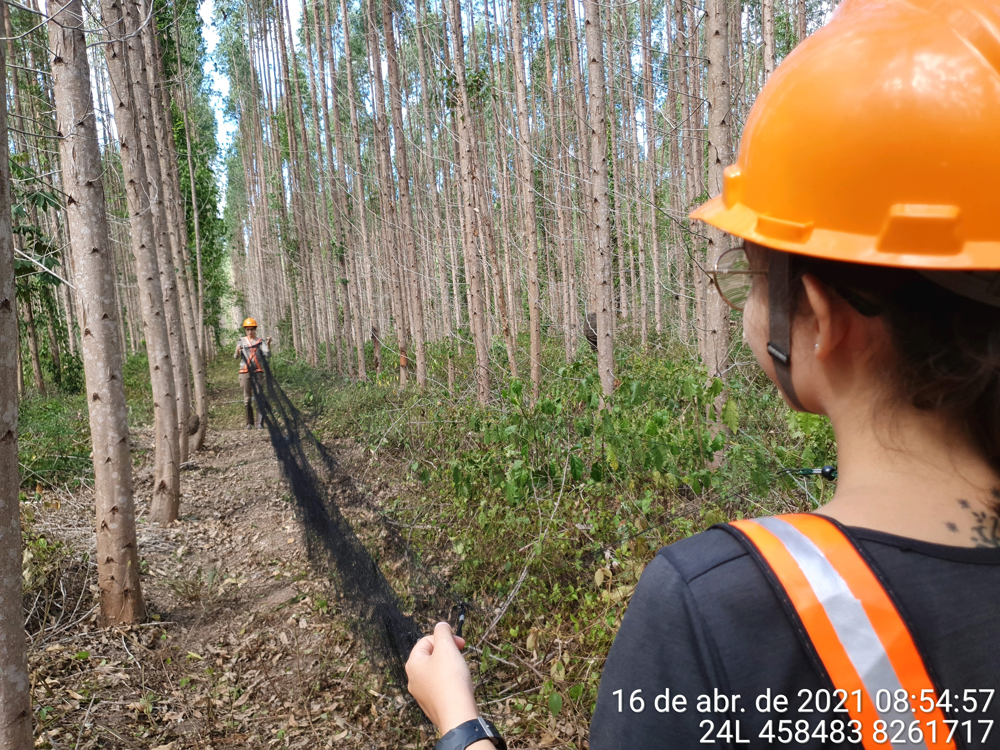
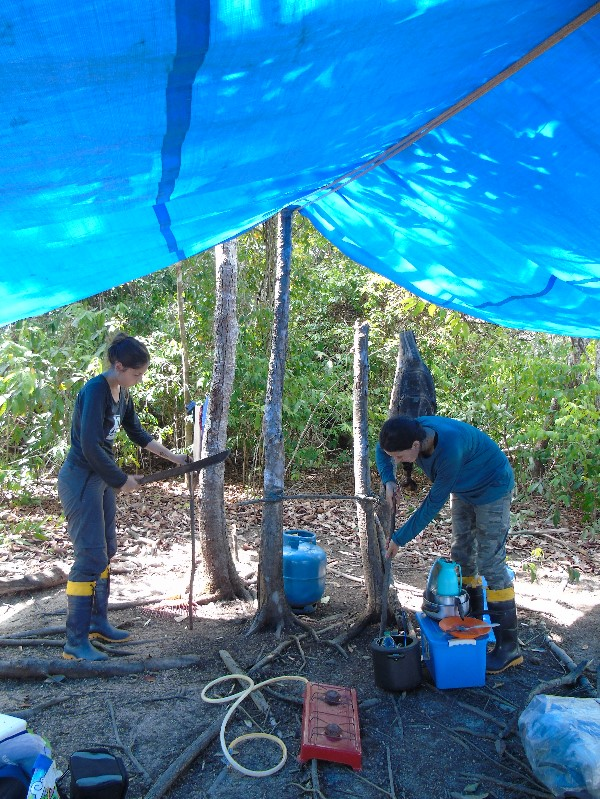
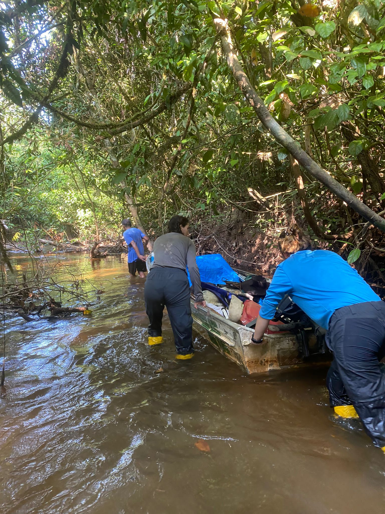

Anyone who thinks that doing fieldwork (in some situations, like ours) is just a matter of enduring months without electricity, a shower, or a refrigerator is mistaken. Fieldwork also involves dealing with situations and people, and this can teach a lot about emotional and social intelligence and interpersonal relationships. Today's text will address a bit of what I faced as a woman leading a research project.

If you are a woman, you probably already have an idea of what I am going to describe in the lines below. Unfortunately, this is something so common and so deeply rooted in our culture that I am sure that, if you have not faced it yourself, you know someone who has. Here, I am referring to sexism in the workplace, specifically in fieldwork.

The first time I came across this was three years ago, when a field assistant refused to work with us because there were only two women on the team. He believed he would have to work twice as hard, carrying materials, for example. At that moment, I was very upset, but I knew that Rayssa, my collaborator and friend, and I worked better than many men out there. That situation passed; we found another assistant and collected the data, all good... Or at least that is what I thought, until I started collecting data for my PhD.

{fig-align="left" width="50%"}

In the 11 months since the start of data collection, we have worked with many different people. Some were excellent and very kind, but others not so much. Some did not want to contribute to the daily tasks of the camp, such as washing dishes or cooking; others did not respect my leadership and planning, going against my decisions in front of the team or belittling my knowledge of the study area.

Uncomfortable comments also came from colleagues who, faced with difficulties of access in certain areas, said we would not be able to make it, since we were two women, while they, two men, had not been able to get in (we did, in fact, get in!).

{fig-align="left" width="50%"}

During this time, these and other situations made me realize that a woman has to do more than a man to be seen and admired. If she does the same, she goes unnoticed, and if she does less, it is simply what is expected. There was even a time when we went to a very isolated area, the Uatumã Grid. To get there, you have to paddle and push the boat up the *igarapé* (a small Amazonian stream), and then walk many kilometers to reach the plot. At that time, the *igarapé* was so dry that we could only set up camp 7 km from the plot, so we had to walk about 14 km every day, carrying our materials just to go to and from the camp. At the end of a day of sampling, after returning to camp, we still had to hear: "You must be tired, right? It's already hard for me, and I'm a man; imagine for you."

{fig-align="left" width="50%"}

I do not think all of these situations happened out of malice. We are dealing with different people, raised in different realities and eras. In addition, the field in which we work is somewhat atypical, and conditions can be stressful, especially because of living together 24 hours a day, for almost 25 days per field campaign.

These experiences taught me that, despite the difficulties, our competence does not need the validation of those who do not believe in us. Each challenge overcome became proof that we are capable of accomplishing everything we set out to do, regardless of the barriers imposed. Today, looking back, I see how much these situations have made me stronger. I continue to lead my fieldwork, trusting my knowledge and my skills, with a team that respects and believes in the work we do. The road is hard, and there are days when it is harder to "swallow my pride," but we keep going.

In the end, what matters is that, with the support of many dear people, we will finish our data collection and remember the good moments. After all, nobody does anything alone.

{fig-align="left" width="50%"}
