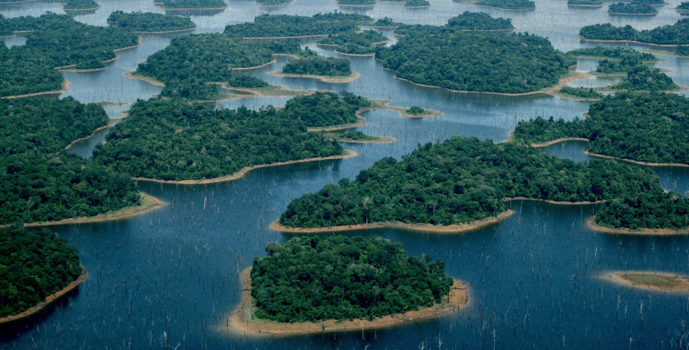

*This text came from a desire to write about the central theme of most of the research I do today: forest insularization. Here, I leave behind islands in the open ocean to arrive at the central subject of this text, which is islands created by hydroelectric dam reservoirs, while also sharing a bit of my personal interests. My goal is to address the concept of insularization and what it causes to biodiversity.* *I hope you enjoy it :)*

## What is an island?

Islands have been in our imagination since the early days of biology, marked by [naturalist expeditions](https://portal.sbpcnet.org.br/noticias/as-expedicoes-naturalistas-no-brasil-no-seculo-xix/) to archipelagos around the world. One of the first naturalists I remember sparking my interest was [Alfred Russel Wallace](https://pt.wikipedia.org/wiki/Alfred_Russel_Wallace), a researcher of limited means whom history has overshadowed, and who, around 1858, during his explorations in the Malay Archipelago, had [his first glimpses of natural selection](https://digitalcommons.wku.edu/cgi/viewcontent.cgi?article=1002&context=dlps_fac_arw).

Alfred is also known as the father of [biogeography](https://pt.wikipedia.org/wiki/Biogeografia), the study of the distribution of species in space and time. If you are a biology student, or are familiar with the subject, you have probably heard the term "biogeography" in another context and with other names: Robert MacArthur and Edward O. Wilson, who proposed the [theory of island biogeography](https://ecovirtual.ib.usp.br/doku.php?id=ecovirt:roteiro:neutr:biogeo_base) (MacArthur & Wilson, [1963](https://www.jstor.org/stable/2407089?origin=crossref), [1967](https://www.jstor.org/stable/j.ctt19cc1t2)).

The theory of island biogeography tells us that the number of species on an island is the result of a balance between the number of species that arrive on the island through immigration and those that disappear through local extinction. For larger and less isolated islands, this balance results in a greater number of species. For smaller and more isolated islands, it results in a smaller number of species. MacArthur and Wilson studied data from different oceanic islands, among them the archipelago of [Melanesia](https://pt.wikipedia.org/wiki/Melan%C3%A9sia), and also [Krakatoa](https://pt.wikipedia.org/wiki/Krakatoa).

Later, the theory of island biogeography left oceanic islands and began to be applied to other ecosystems as well, including terrestrial environments ([Diamond, 1975](https://www.sciencedirect.com/science/article/abs/pii/000632077590052X?via%3Dihub)). This ended up changing the very conception of what could be considered an "island."

Since Wallace and the early days of biogeography, our knowledge about islands has expanded considerably. Today we know that these stretches of "land" surrounded by water can have different origins (volcanic, continental, coralline) and that this term can even cover less obvious environments, such as lakes, mountaintops, or pieces of a previously continuous forest ([Matthews & Triantis, 2021](https://www.cell.com/current-biology/fulltext/S0960-9822(21)00988-X?_returnURL=https%3A%2F%2Flinkinghub.elsevier.com%2Fretrieve%2Fpii%2FS096098222100988X%3Fshowall%3Dtrue)). In this context, an **island is an environment surrounded by another that is unsuitable for the persistence of species**.

00988-X?_returnURL=https%3A%2F%2Flinkinghub.elsevier.com%2Fretrieve%2Fpii%2FS096098222100988X%3Fshowall%3Dtrue) **Different types of islands**: (A) Pico Island, in the Azores, an oceanic island of volcanic origin; (B) many island-like systems have been identified in the marine environment, such as seamounts; (C) atolls are islands formed by coral reefs; (D) insular forest fragments surrounded by agricultural areas; (E) islands within lakes; and (F) lakes, which can be considered islands from the point of view of aquatic animals.](Matthews_Triantis_2021.png){fig-align="left"}

## Islands created by the flooding of the forest

The process of creating islands is called insularization. In Brazil ([Fearnside, 2015](https://fmclimaticas.org.br/wp-content/uploads/2015/07/Hidrel%C3%A9tricas-na-Amaz%C3%B4nia-Impactos-ambientais-Sociais..-V.1.pdf)), and especially in the tropical region of the world ([Finer & Jenkins, 2012](https://journals.plos.org/plosone/article?id=10.1371/journal.pone.0035126); [Zarfl et al., 2015](https://link.springer.com/article/10.1007/s00027-014-0377-0)), **the creation of hydroelectric dams floods previously continuous forests and, when the topography allows, forms forest islands on former hilltops**. When this happens, part of the forest is lost and the rest is divided into islands of different sizes, which come to be surrounded by a contrasting environment: water.

This process, which takes years to complete, actually begins long before the damming of the river itself. Much is planned, such as the removal of vegetation and the rescue of wildlife, [but what actually happens is different](https://rainforestjournalismfund.org/pt-br/stories/novas-hidreletricas-na-amazonia-ignoram-normas-e-causam-estragos-ambientais). The impacts of building the dam have lasting effects and affect not only fauna and flora, but also [Indigenous and riverside populations, with consequences that reverberate for a long time after the flooding](https://rainforestjournalismfund.org/pt-br/stories/terra-arrasada-os-atingidos-por-belo-monte). There are many of these dams where the story was similar. Some names I recall right now are [Balbina](https://amazoniareal.com.br/os-25-anos-da-usina-hidreletrica-de-balbina-parte-i/), [Tucuruí](https://mapadeconflitos.ensp.fiocruz.br/conflito/pa-atingidos-por-barragens-indigenas-quilombolas-e-comunidades-tradicionais-de-tucurui-lutam-por-seus-direitos/), and [Belo Monte](https://amazoniareal.com.br/belo-monte-o-paquiderme-de-energia-parado/). At Balbina, for example, an area of more than 310,000 hectares of forest was flooded, creating more than 3,500 islands of different sizes ([Benchimol & Peres, 2015](https://besjournals.onlinelibrary.wiley.com/doi/10.1111/1365-2745.12371)).

{fig-align="left"}

## Environmental changes after insularization and their consequences for biodiversity

Island size can limit the number of species that live on it ([Arrhenius, 1921](https://www.jstor.org/stable/2255763?origin=crossref); [MacArthur & Wilson, 1967](https://www.jstor.org/stable/j.ctt19cc1t2)) as well as the amount of resources available to those species. In addition, larger islands can offer a greater variety of environments, such as [edge and interior areas](https://anotherecoblog.wordpress.com/2023/03/23/efeitos-de-borda-fantasticos-e-como-encontra-los-ou-nao/) ([Banks-Leite et al., 2010](https://nsojournals.onlinelibrary.wiley.com/doi/10.1111/j.1600-0706.2009.18061.x)), and therefore harbor more species. They also tend to sustain larger populations, which reduces the risk of local extinction. On small islands, on the other hand, populations are usually smaller and more vulnerable to disappearance ([Aurélio-Silva et al., 2016](https://doi.org/10.1016/j.biocon.2016.03.016)).

[Compared with forest patches of similar size surrounded by terrestrial environments, small islands surrounded by water harbor fewer bird species](https://theconversation.com/pequenos-fragmentos-florestais-podem-conservar-mais-aves-quando-o-entorno-e-favoravel-283861), for example. This happens because birds living in forest fragments surrounded by terrestrial environments can use this environment to move around, as well as its resources, such as insects and flower nectar, which generally does not occur when the adjacent environment is aquatic ([Bueno et al., 2026](https://www.pnas.org/doi/10.1073/pnas.2521783123)).

With the creation of forest islands, environmental conditions change. For example, the amount of light that penetrates the interior of the island and the intensity of the wind increase, while air and soil humidity decrease ([Laurance et al., 2002](https://conbio.onlinelibrary.wiley.com/doi/10.1046/j.1523-1739.2002.01025.x)). Some species cannot tolerate these new conditions and quickly disappear, while others persist for some time before also disappearing ([Kuussaari et al., 2009](https://www.cell.com/trends/ecology-evolution/abstract/S0169-5347(09)00191-8?_returnURL=https%3A%2F%2Flinkinghub.elsevier.com%2Fretrieve%2Fpii%2FS0169534709001918%3Fshowall%3Dtrue)). In the region of the Balbina Hydroelectric Dam, for example, [mammals, birds, and turtles continued to disappear from the islands even 26 years after isolation](https://www.eurekalert.org/news-releases/886933).

This delay in local extinctions after forest insularization is known as extinction debt ([Kuussaari et al., 2009](https://www.cell.com/trends/ecology-evolution/abstract/S0169-5347(09)00191-8?_returnURL=https%3A%2F%2Flinkinghub.elsevier.com%2Fretrieve%2Fpii%2FS0169534709001918%3Fshowall%3Dtrue); [Jones et al., 2016](https://www.sciencedirect.com/science/article/abs/pii/S0006320716301732?via%3Dihub)), in which the island loses species until it reaches a new equilibrium with a community with fewer species.

Extinction debt is also influenced by island area: smaller islands lose species more quickly and therefore pay off their extinction debt more quickly than larger islands ([Gibson et al., 2013](https://www.science.org/doi/10.1126/science.1240495); [Jones et al., 2016](https://www.sciencedirect.com/science/article/abs/pii/S0006320716301732?via%3Dihub)). Larger islands, on the other hand, act as temporary refuges, allowing some species to survive on borrowed time, delaying their local extinctions ([Uezu & Metzger, 2016](https://journals.plos.org/plosone/article?id=10.1371/journal.pone.0147909)). For this reason, the populations of these species can be called "living dead."

## What can we take from this text?

With this text, I hope to have clarified how the creation of hydroelectric dams affects biodiversity even decades after the damming of a river. The text may be a bit discouraging, especially when we consider the hydroelectric potential that is planned to be exploited in the Amazon... but not all is lost (vote for candidates who take the environmental agenda seriously in the election we will have in four days!).

Islands surrounded by an aquatic matrix represent the worst-case scenario of insularization, and their consequences are truly drastic. Thus, understanding the immediate and long-term impacts that hydroelectric dams have on the forest can guide decision-making aimed at biodiversity conservation. Extinction debt itself can be halted if there are conservation measures, such as habitat restoration and landscape management ([Lira et al., 2012](https://besjournals.onlinelibrary.wiley.com/doi/10.1111/j.1365-2664.2012.02214.x)).

Almost two centuries after Wallace explored the Malay Archipelago and began to understand natural selection, islands remain natural laboratories. If they once helped us understand how species arise, they now also help us understand how we lose them.

*Cover image credits: [André Dib](https://www.nationalgeographicbrasil.com/fotografo/andre-dib)*
