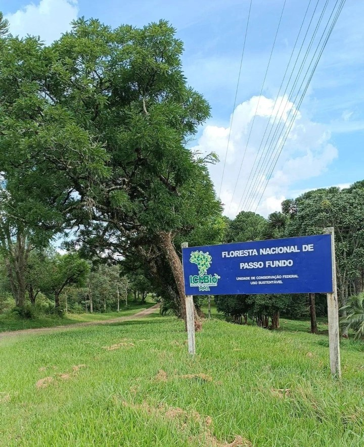
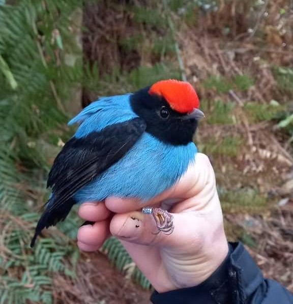
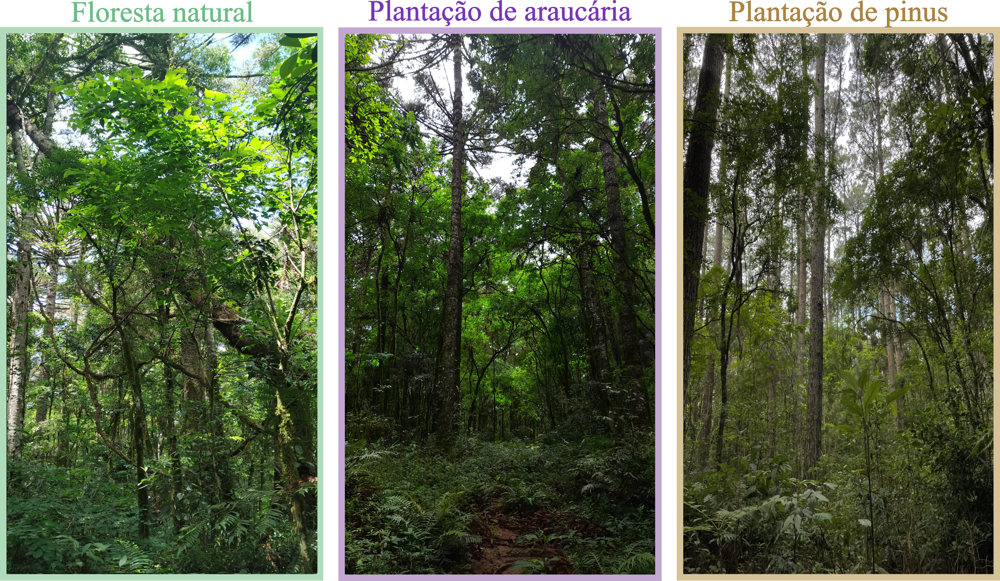
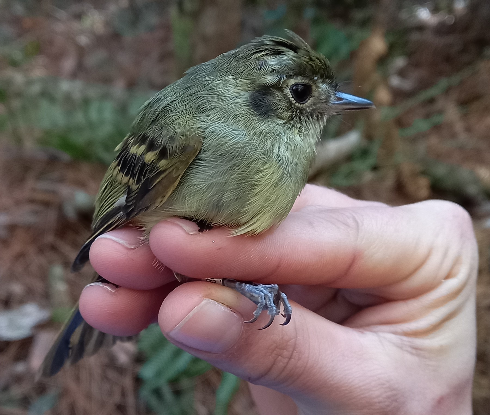

*Today's post is about sharing a very special milestone: we have published our first paper in a Qualis A1 international journal, written and led by current and former students of the Instituto Federal Farroupilha - Campus Júlio de Castilho. This is the institution where I graduated and where now I have the great pleasure of working as a collaborator at the Núcleo de Pesquisas em Ciências Biológicas (NPCBio). One detail that makes this work even more meaningful is that it is a local study, conducted in Rio Grande do Sul by people from the region themselves. I clearly remember the moment, five years ago, when the first plots of the permanent research site – a modified RAPELD [(Magnusson et al., 2005)](https://www.scielo.br/j/bn/a/f77RCKmNYmkHFxBLcFRFgSL/?format=pdf&lang=en) – were stablished on Passo Fundo National Forest, where the study was conducted. This article is the first publication resulting from this collective effort. Below, I share the main findings of the study.*

Natural forest areas have been declining worldwide, mainly due to land conversion for agricultural and livestock activities. At the same time, the area occupied by tree plantations has been increasing, driven by growing demand for timber, pulp, and, more recently, carbon credits. In this context, a central question arises: can tree plantations help conserve forest biodiversity?
In this study, we investigated whether plantations of native (*Araucaria angustifolia*) and exotic (*Pinus elliottii*) tree species can support bird communities found in natural Mixed Ombrophilous Forests, also known as Araucaria Forests. We also aimed to identify bird species that could serve as indicators of these different forest types.

This study was conducted in the Passo Fundo National Forest, in northern Rio Grande do Sul (Fig. 1). Fieldwork lasted one year, from June 2021 to May 2022. We sampled birds using mist nets throughout the four seasons. The fieldwork was led by **Rayssa T. Amarante**, with the valuable collaboration of **Raquel T. Amarante** and **Felipe Brum**. I took part in the autumn field campaign (April–May 2022), and it was the coldest fieldwork experience I have ever had! (Fig. 2). I even remember how the birds looked like little fluffy balls, fluffing up their feathers to trap heat and keep warm (Fig. 3). Throughout the entire process, from data collection to the publication of the article, we were supervised by Professor **Anderson Saldanha Bueno** (Fig. 4).

{.uniform-img fig-align="left"}

{.uniform-img fig-align="left"}

{.uniform-img fig-align="left"}

{.uniform-img fig-align="left"}

In total, we sampled 18 areas, divided into three groups of six, corresponding to the three forest types studied: natural forest, araucaria plantations, and pine plantations (Fig. 5). In each area, we also measured understory vegetation obstruction, an important feature for assessing the availability of resources and shelter for birds.

{fig-align="left"}

It is worth noting that the plantations we sampled are old, ranging from 49 to 71 years in age, and are located close to natural forest fragments of at least 10 hectares. These conditions create a relatively “benign” environmental setting, meaning one that is more favorable to the presence of forest bird species.

Throughout the study, we captured 1,073 birds belonging to 51 different species. Our results showed that tree plantations, both native and exotic, can support bird communities similar to those found in natural forests when located in a benign environmental context, characterized by a well-developed understory, older plantation age, and proximity to natural forest fragments. This similarity in bird communities was even more pronounced in native tree plantations, suggesting that they have greater potential for conserving forest birdlife.

Of the 51 species captured, 45 were forest species. Among them, only one species (*Leptopogon amaurocephalus*) (Fig. 6) was associated with natural forest. This suggests that, for many forest species, native and exotic tree plantations in a benign environmental context can act as complementary or alternative habitats.

{.uniform-img fig-align="left"}

Still, it is important to highlight that bird communities in natural forests are more intact than those found in plantations. In other words, the variety of species and the number of individuals of each species are more similar among natural forests than between natural forests and plantations. Therefore, the preservation of natural forests is irreplaceable for bird conservation.

Furthermore, maintaining natural forests benefits not only the species living within them but also increases the conservation value of nearby plantations, which often depend on this proximity to support more diverse and representative bird communities.

The paper presenting the research findings was published on July 21, 2025, in the scientific journal **Forest Ecology and Management** and can be accessed through the following link: <https://doi.org/10.1016/j.foreco.2025.122985>.
