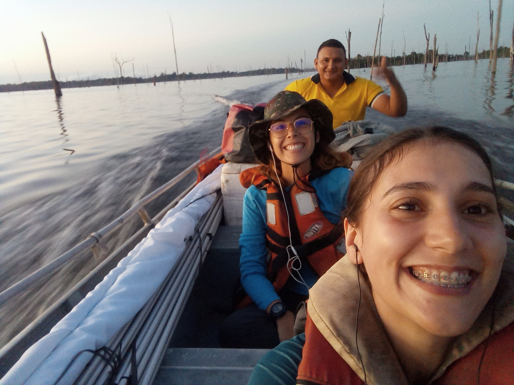
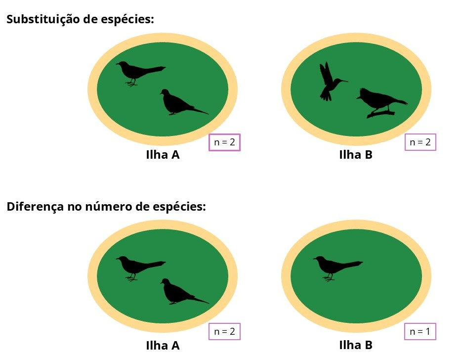

*Today I want to share a bit about a paper we just published in [Royal Society Open Science](https://royalsocietypublishing.org/rsos), led by Rayssa Tormes do Amarante, my friend and research partner. This publication is the result of a collaborative effort to understand what happens to bird communities when a continuous forest is transformed into a set of islands. In this post, I want to tell you a little about the study, our adventures, the main results we found, and what they can tell us about the effects of this environmental transformation on biodiversity.*

It is four in the afternoon and we are in the *voadeira* (a small aluminum motorboat), after an intense day of fieldwork. We have been sampling understory birds since six in the morning. Rayssa is sitting in front of me and Maciel steers the boat as we cross the reservoir of the Balbina Hydroelectric Dam. It is hard to imagine that, before 1987, this entire landscape was a continuous forest. Today, the islands we see are the former hilltops of that forest, surrounded by a matrix of water dotted with dead trees. This process of transformation of a continuous forest into forest islands is called forest insularization.

{.uniform-img fig-align="left"}

When the forest was flooded, islands of different sizes and degrees of isolation were created. Compared with continuous forest, islands as small as a soccer field have less habitat available and are more exposed to so-called edge effects, which are environmental changes such as increased temperature and light incidence. Isolation, caused by the water around the islands, makes it harder for forest-dependent birds to arrive, reducing the movement of individuals between islands.

The environmental changes caused by the creation of islands can lead not only to the loss of species, but also to the loss of the ecological functions that these species perform on the islands. When a group of species uses similar resources and can perform similar ecological functions, this group is called a guild. For example, some birds that feed on fruit, which is the resource, can disperse seeds, which is the ecological function.

.](Turdus_albicollis_Beco-do-Catitu_2023-10-27_L4.jpg){.uniform-img fig-align="left"}

When a guild disappears from an island, we lose the ecological functions that this group of species performed, and not only the species that were part of the guild. As a consequence, bird communities on islands become increasingly different from those found in continuous forests.

These differences can occur mainly in two ways: through species replacement or through differences in the number of species. Replacement happens when species present in one place are replaced by others, while differences in the number of species occur when one place has more or fewer species than another.

{fig-align="left"}

It is in this context that we sought to understand how forest insularization affects understory bird communities, evaluating how island size and isolation influence differences in species composition and in the ecological functions they perform. We also investigated whether these differences are caused by species replacement or by differences in the number of species among sites.

To investigate these questions, we sampled birds on 32 islands and in five continuous forest areas in the reservoir of the Balbina Hydroelectric Dam, in Amazonas, between June and December of 2023 and 2024. In total, we captured 1,634 individuals belonging to 114 bird species. These species performed different ecological functions, distributed across 32 guilds.

When we compared the communities, we found that island communities were more different from each other than continuous forest communities were. In the continuous forest areas, most of the difference between communities was caused by species replacement. In other words, different sites had different sets of species, but a similar number of species. On the islands, on the other hand, the differences were caused by the number of species, indicating that some islands had more species than others.

Ecological functions also differed more among islands than in the continuous forest. In this case, the differences were determined mainly by the number of guilds, indicating that some islands harbored a larger set of ecological functions than others. In addition, the greater the differences in size and isolation between two islands, the greater the differences between their communities.

In the end, what this set of islands shows us is that the effects of insularization can go beyond the loss of species. Island size and isolation work as filters that influence which species are able to remain in these fragments and, consequently, which ecological functions continue to be performed.

Over time, this process can produce communities that are increasingly different from each other and have fewer ecological functions. Thus, transforming a continuous forest into a set of islands does not only mean reducing the amount of available habitat; it also means reorganizing the communities that live there and potentially changing how these ecosystems function.

So, answering the question in the title, **"what happens to birds when a continuous forest becomes a set of islands?"**, when a continuous forest becomes a set of islands, bird communities change. As a result, some species disappear or stop arriving on the islands, causing them to have different numbers of species and ecological functions. Thus, the bird communities of the islands become more different from each other and from those found in the continuous forest.

The full paper can be found at <https://royalsocietypublishing.org/rsos/article/13/8/rsos260165/482732/Habitat-insularization-alters-taxonomic-and>

If you liked this post and are interested in ecology and biodiversity conservation, here is a reading suggestion:

- [Um naturalista no Antropoceno (A naturalist in the Anthropocene), by Professor Mauro Galetti](https://books.scielo.org/id/p5cwn).

In this book, the author invites us to think about changes in nature based on field experiences and reflections on biodiversity in the Anthropocene.

*Cover image credits: [Luciane Moral](https://oeldoradoeaqui.blogspot.com/2010/12/lago-de-balbina-presidente-figueiredo.html)*

*Credits for the bird silhouettes used in the schematic figure: [Phylopic](https://www.phylopic.org/nodes/667b8664-5dd7-487e-ba56-c6c5c95055a2/aves-silhouettes)*
