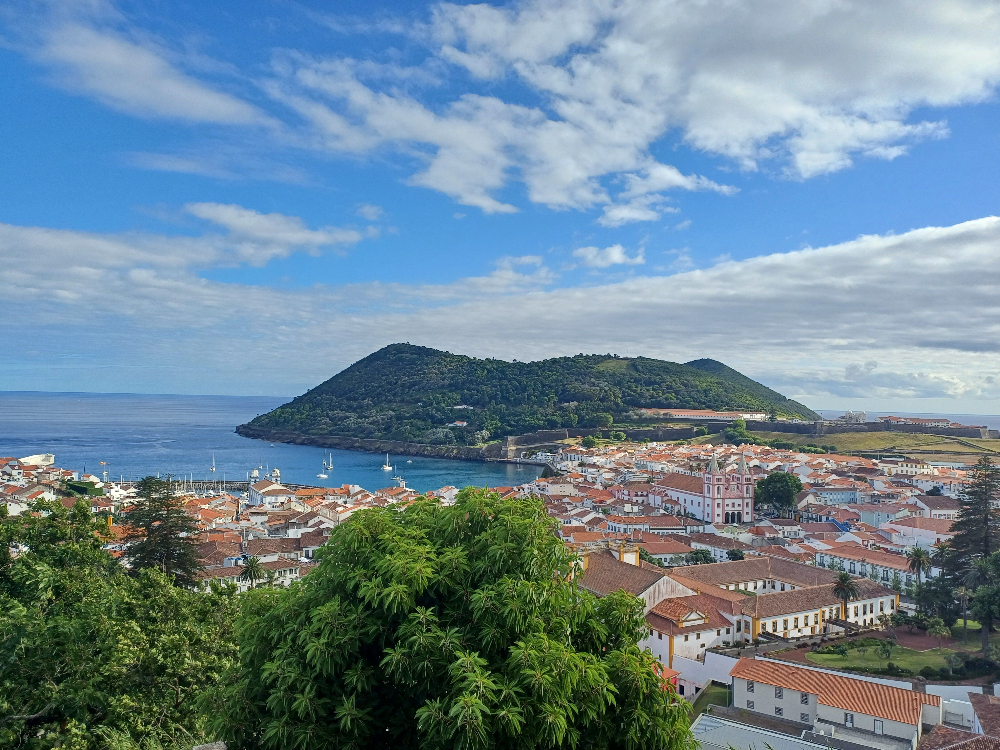
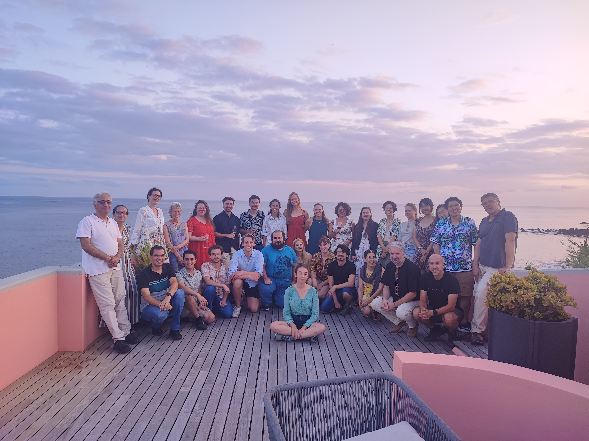
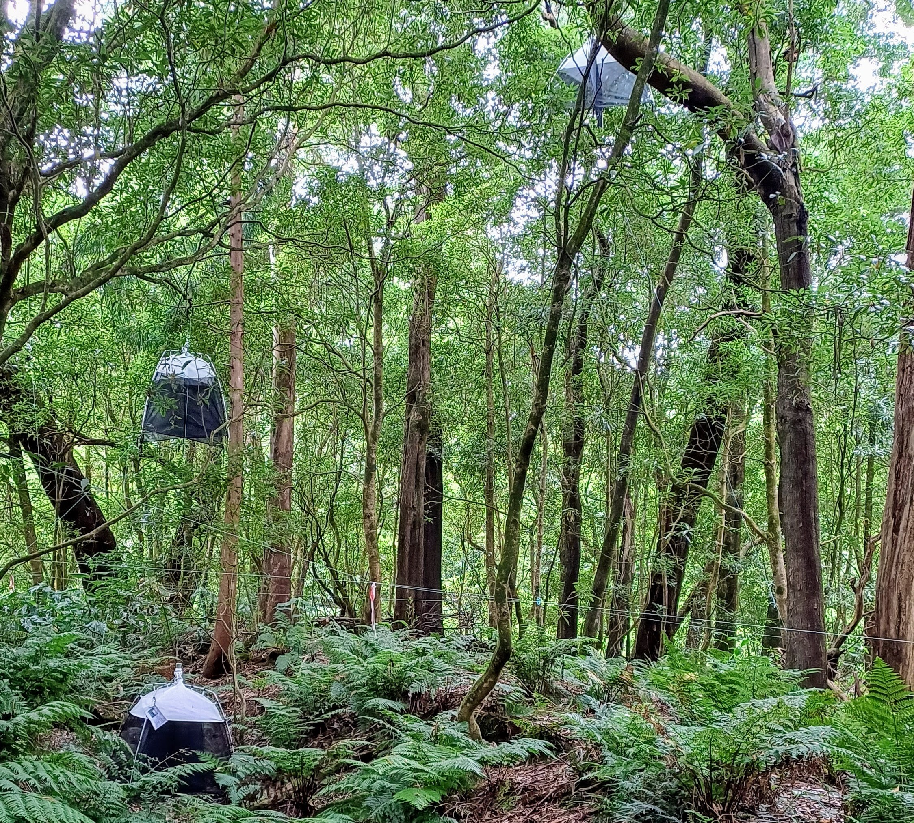
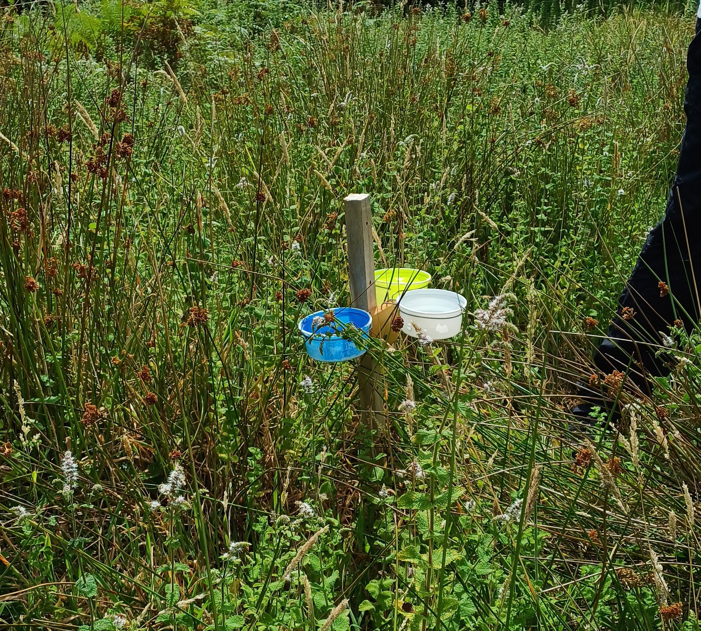
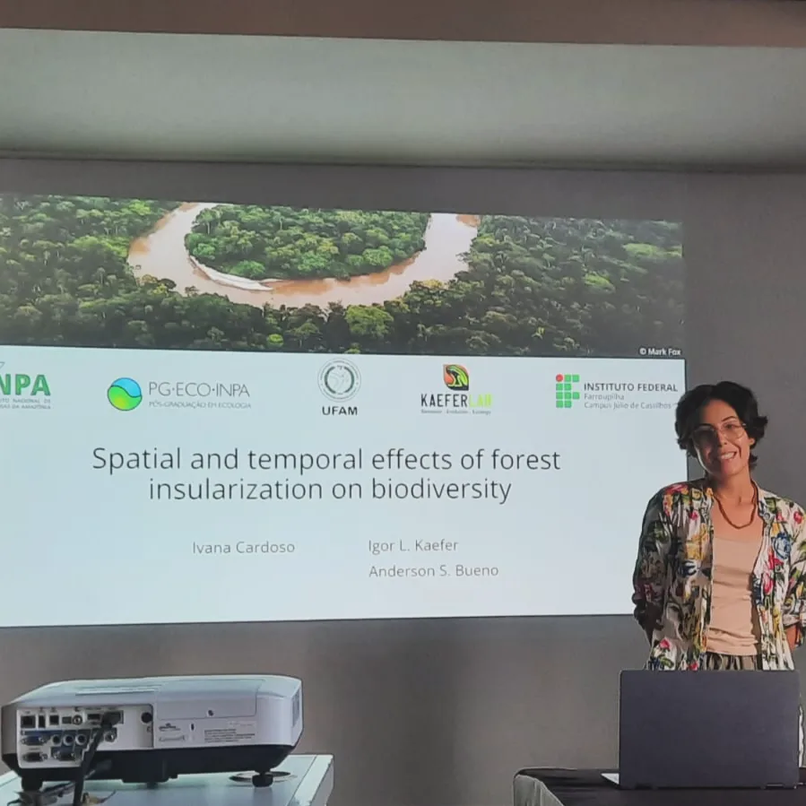

Located on the [Mid-Atlantic Ridge](https://en.wikipedia.org/wiki/Mid-Atlantic_Ridge), the [Azores archipelago](https://en.wikipedia.org/wiki/Azores) is made up of nine volcanic islands, formed in the late Tertiary. Among them is [Terceira Island](https://en.wikipedia.org/wiki/Terceira_Island), which emerged about 3.52 million years ago and has an area of approximately 402 km². One of Terceira's municipalities is [Angra do Heroísmo](https://en.wikipedia.org/wiki/Angra_do_Hero%C3%ADsmo), which is today a UNESCO World Heritage Site.

{fig-align="left" width="60%"}

Between the end of July and the beginning of August 2024, this municipality welcomed students from many parts of the world to take part in the summer course [*Island Biogeography and Macroecology*](https://gba.uac.pt/training/ver.php?id=8). I was one of those students, the only Brazilian and one of three people from the Global South. It is about this experience that I will write in the lines below.

{fig-align="left" width="60%"}

On July 19, 2024, I left Manaus, Amazonas, and, as my co-advisor says, *took off on the wings of science* for my first academic experience outside Brazil. At that moment, I had no idea how much my worldview would be broadened and how much I would be inspired.

Starting on July 22, the course began and we had classes with professors at the frontier of knowledge. We discussed ecological and evolutionary theories, explored the processes that shape island communities, and learned about methods and tools for calculating different dimensions of diversity.

In addition to lectures, we also had a field class, where we learned methods for collecting arthropods, pollinators, and bryophytes. We got to know new environments, such as the [laurel forest (Laurisilva)](https://en.wikipedia.org/wiki/Laurisilva), and learned to recognize endemic species, such as [*Erica azorica*](https://azoresbioportal.uac.pt/pt/especies-dos-acores/erica-azorica-10091/a), [*Laurus azorica*](https://azoresbioportal.uac.pt/pt/especies-dos-acores/laurus-azorica-10116/), and [*Juniperus brevifolia*](https://azoresbioportal.uac.pt/pt/especies-dos-acores/juniperus-brevifolia-brevifolia-6423/), and invasive ones, such as [*Hedychium gardnerianum*](https://azoresbioportal.uac.pt/pt/especies-dos-acores/hedychium-gardnerianum-6413/) and [*Hydrangea macrophylla*](https://azoresbioportal.uac.pt/pt/especies-dos-acores/hydrangea-macrophylla-6519/), which surprisingly cover large areas on Terceira.

{fig-align="left" width="60%"}

{fig-align="left" width="60%"}

In the course, I not only gained knowledge and tools that will raise the quality of my PhD project, but I was also inspired by the projects of incredible people who are also dedicated to understanding and defending biodiversity in different parts of the world. We shared experiences, cultures, and ideas, as well as solutions to challenges common to our research. It was fascinating to see how, even in a field as specific as island biogeography, there is such a richness of topics and perspectives.

The professors gave us inspiring words, stressing the importance of the new generation of scientists and the need for persistence in the face of the adversities of science. One message that stayed with me was that, even in the face of difficulties, perseverance is essential.

Before setting off on this journey, I was accompanied by fear of the unknown and by insecurity. However, by taking part in the course, I experienced a transformative personal and professional impact that I would not have had otherwise.

I am writing this post to record this experience and also to thank everyone in my support network who shared this joy with me, and the [PPGECO](http://www.ppginpa.eco.br/index.php/pt-br/) (Graduate Program in Ecology) at INPA, which made it possible for me to take part in the course.

{fig-align="left" width="60%"}
