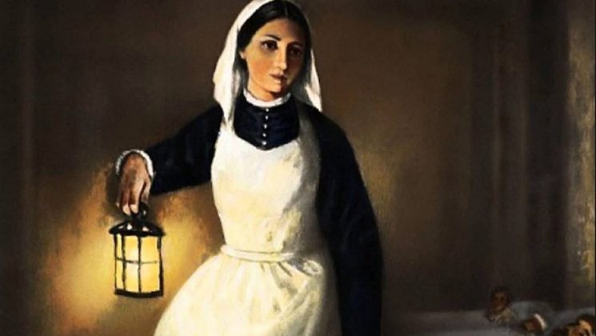
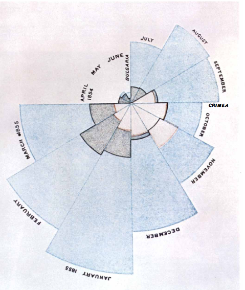
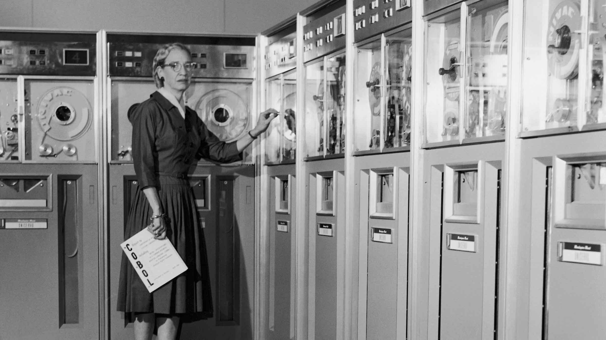
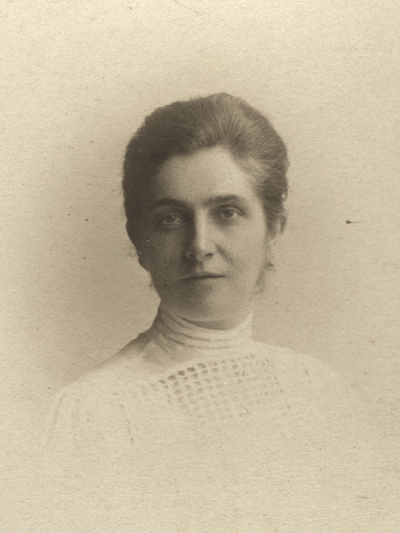

Women have faced challenges and discrimination, especially in their pursuit of education and recognition in science. For a long time throughout history, we were considered intellectually inferior and excluded from spaces of scientific research and production.

Despite the emergence of universities in the Middle Ages, such as the University of Bologna in 1088, we only gained the right to attend them in 1879, with permission from our fathers or husbands. In addition to restrictions on access to education, many women were overshadowed, and credit for their scientific work was given to men, as in the cases of [Lise Meitner](https://doi.org/10.1590/1806-9126-RBEF-2022-0103) and [Rosalind Franklin](https://pubs.aip.org/physicstoday/article/56/3/42/412288).

Currently, female representation in scientific research remains unequal, with only [33% of researchers worldwide being women](https://www.unesco.org/pt/days/women-girls-science) (2023). In Brazil, [women account for 35% of the approximately 21,000 CNPq scholarship recipients](https://piaui.folha.uol.com.br/cada-100-bolsistas-do-cnpq-65-sao-homens-e-35-sao-mulheres/) (2022). These numbers highlight the ongoing need to promote gender equality and recognize the crucial role of women in science.

Today is the International Day of Women and Girls in Science. For this reason, this post aims to explore the journeys of three women scientists who challenged the norms of their time and paved the way for other women. One of them was a pioneer in data visualization, another developed the first programming language to use words, and the last was the first woman to lead a scientific institution in South America. I hope these stories inspire and encourage more women and girls to pursue their dreams and contribute to scientific and technological progress.

## Florence Nightingale (1820 - 1910)

{fig-align="left" width="40%"}

Florence was a nurse who revolutionized the field of nursing through the first graphical representations of statistical data. She began working at the age of 33 and, after one year, was appointed head nurse during the [Crimean War](https://pt.wikipedia.org/wiki/Guerra_da_Crimeia).

During her time in the war, she realized that better hygiene conditions in hospitals could reduce the soldiers' mortality rate. However, convincing those in power that improving sanitary conditions would save many lives was not an easy task. Besides being a woman, she was a civilian, and her authority was independent of the Armed Forces. So, to convince them of the need for change, she turned to the numbers:

When Florence arrived in February 1855, the mortality rate was 42.7%. Six months after her arrival and the implementation of her sanitary reforms, the mortality rate had dropped to 2.2%.

Florence was a pioneer in the graphical representation of statistics. She invented polar area diagrams to show how many deaths could have been prevented if these sanitary measures had been implemented earlier. Below is the original figure created by Florence:

{fig-align="left"}

In the diagram above, the blue areas represent preventable deaths (such as those caused by infectious diseases), the brown areas represent deaths from wounds, and the grey areas represent deaths from other causes. Note that the mortality peak occurred in January 1855, with a total of 3,168 deaths - 2,761 from infectious diseases and 83 from wounds. This diagram is included in Florence's book *Notes on Matters Affecting the Health, Efficiency and Hospital Administration of the British Army* (1858). However, I took this information from a [paper written by Bernard Cohen in 1984](https://www.jstor.org/stable/24969329).

## Grace Hopper (1906 - 1992)

{fig-align="left" width="40%"}

Grace was a pioneer in computer programming and has inspired, and continues to inspire, many [women in STEM](https://www.aauw.org/resources/research/the-stem-gap/) (Science, Technology, Engineering and Matematics), a field that is still predominantly male.

In 1928, Grace graduated in Mathematics and Physics from Vassar College and became a mathematics professor at the same institution in 1931. She also earned a master's degree (1930) and a PhD in Mathematics (1934) from Yale University.

In 1939, with the beginning of World War II, she interrupted her teaching career to enlist in the U.S. Navy. There, Grace was assigned to work on [Howard Aiken's](https://pt.wikipedia.org/wiki/Howard_Aiken) computers, becoming the third programmer, and the only woman, to work on the [Mark I](https://pt.wikipedia.org/wiki/Harvard_Mark_I).

She was the one who proposed the creation of a programming language entirely in English, developing the first English-language data-processing compiler. Her work not only simplified computer programming but also opened the door to a new era of accessibility in information technology.

## Emilie Snethlage (1868-1929)

{fig-align="left" width="40%"}

Emilie was an ornithologist and naturalist, known for her work in the Amazon. She was also the first woman to lead a scientific institution in Latin America.

In 1899, she began studying natural history at the University of Berlin, and five years later, she earned a PhD in Science from the University of Freiburg.

In 1905, she began her career as a zoology assistant at the Berlin Museum of Natural History. However, later that same year, she moved to Belém to work at the Paraense Museum of Natural History and Ethnography, now known as the [Emilio Goeldi Museum](https://www.gov.br/museugoeldi/pt-br). From then on, she led several expeditions across the Amazon, one of the most notable being her exploration of the region between the Xingu and Tapajós rivers in 1909.

Emilie was the director of the Emilio Goeldi Museum between 1914 and 1922, making her the first woman to lead a scientific institution in Latin America. Among her most notable works is the *Catalogue of Amazonian Birds* (1914), which included 1,117 Amazonian bird species. [Helmut Sick](https://en.wikipedia.org/wiki/Helmut_Sick) dedicated his book *Brazilian Ornithology* to her in 1985.

In this post, we explored the journeys of three women scientists whose contributions continue to resonate in the fields of statistics, programming, and ornithology — topics that are at the heart of the biRd blog. May these stories inspire our ongoing commitment to gender equality and to supporting women and girls on their journey toward knowledge and scientific discovery.

*Cover image credits: [Freepik](https://www.freepik.com/free-vector/flat-international-day-women-girls-science-background_133721459.htm#from_view=detail_serie)*
