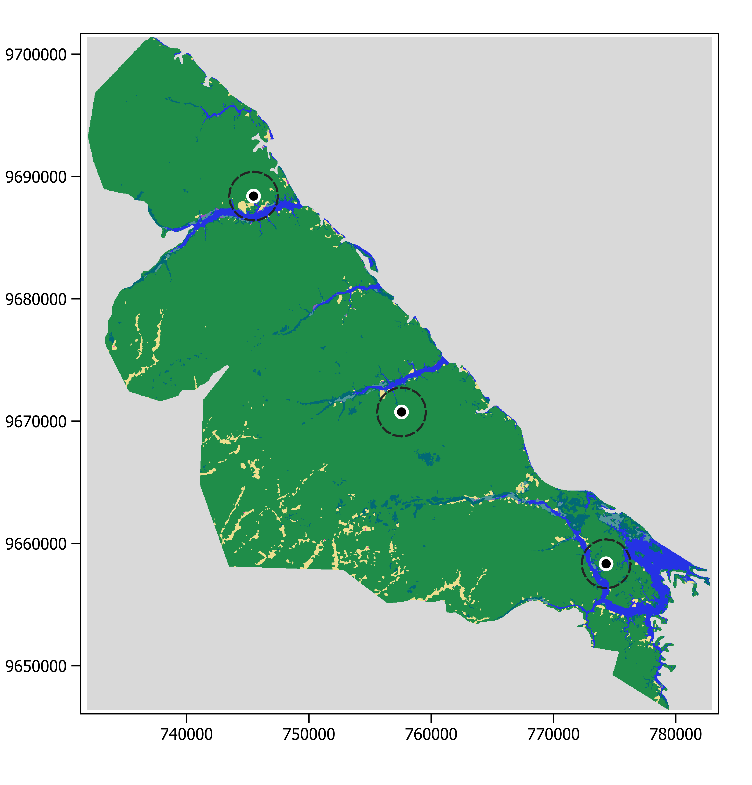
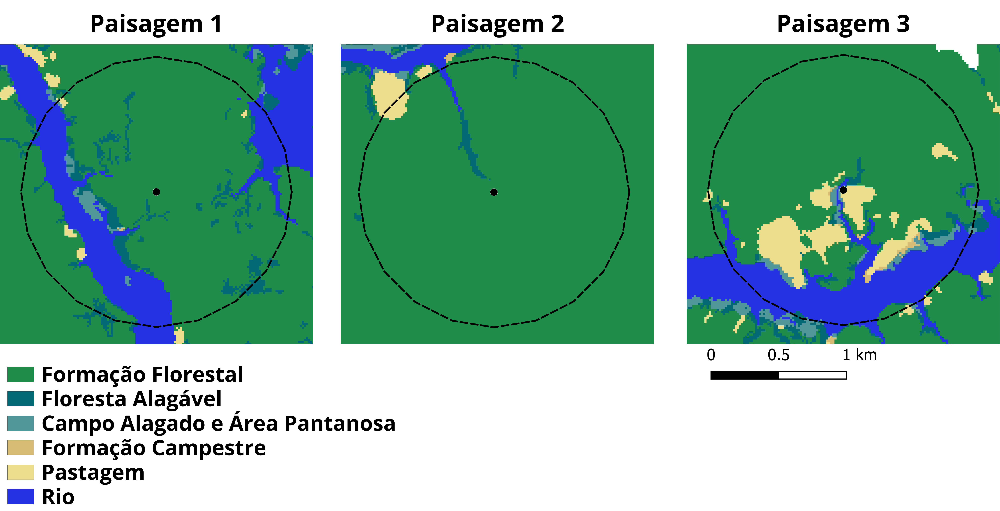

[In landscape ecology](https://www.scielo.br/j/bn/a/Jbchd6rjY35PGkY5BHPz63S/), a landscape can be defined as a mosaic of land uses that interact with each other at a given scale, and it can be characterized by its composition and configuration. Landscape composition refers to the amount of the different elements in the landscape, while configuration refers to the spatial arrangement of these elements.

For example, forest cover is a measure of landscape composition that represents the amount of forest, usually expressed as a percentage, within the landscape. Greater forest cover can indicate greater species diversity and resource availability [(reviewed by Arroyo-Rodríguez et al., 2020)](https://onlinelibrary.wiley.com/doi/epdf/10.1111/ele.13535). The number of fragments, on the other hand, is a measure of landscape configuration that represents the level of fragmentation of that landscape. For a given amount of habitat, more fragments can facilitate species movement [(reviewed by Arroyo-Rodríguez et al., 2020)](https://onlinelibrary.wiley.com/doi/epdf/10.1111/ele.13535).

The scale at which landscape composition and configuration are calculated strongly influences the relationship between species and the landscape. For this reason, it is advisable to carry out a multi-scale analysis to select a scale, called the [scale of effect](https://onlinelibrary.wiley.com/doi/pdf/10.1111/geb.12233), that produces the strongest relationship between your species-related response variable and your landscape-related predictor variable. For example, a study on birds used a multi-scale analysis to evaluate the relationship between [the number of species and the amount of available habitat](https://onlinelibrary.wiley.com/doi/abs/10.1111/jbi.13499) in the landscape.

In today's post, we will learn how to calculate landscape composition in the R software using the [landscapemetrics](https://r-spatialecology.github.io/landscapemetrics/index.html) package. For this, we will use, for didactic purposes, only a few landscapes and a single scale of 2000 m. However, remember to evaluate whether a multi-scale analysis would be appropriate for your case.

The study area I chose was the [Rio Negro Sustainable Development Reserve (RDS)](https://ppbio.inpa.gov.br/sitios/RDS_Rio_Negro), in Amazonas. I downloaded the land use and land cover raster for the area from [MAPBIOMAS](https://brasil.mapbiomas.org/colecoes-mapbiomas/) for the year 2022 (collection 8). The file is available on my [GitHub](https://github.com/Ivana-Cardoso/Ivana-Cardoso.github.io/tree/main/posts/Composicao_paisagem), but if you prefer to download it directly from the original website, I suggest using the [Toolkit](https://www.youtube.com/watch?v=OBqaoSuLGbk&ab_channel=MapBiomasBrasil) in Google Earth Engine and paying attention to the Coordinate Reference System (CRS) you choose.

## Calculating landscape composition

```{r, output = FALSE}
# Install the necessary packages
if (!requireNamespace(c("terra", "landscapemetrics", "sf"), quietly = TRUE)) {
  install.packages(c("terra", "landscapemetrics", "sf"))
}

# Load the necessary packages
library(terra)
library(landscapemetrics)
library(sf)
```

```{r}
#| code-overflow: wrap
# Set your working directory
setwd("C:/Users/ivana/OneDrive/Ivana-Cardoso.github.io/posts/Composicao_paisagem") # Don't forget to change this to the folder where you will save the downloaded raster
```

```{r}
# Import the raster
# You can download it at:
# https://github.com/Ivana-Cardoso/Ivana-Cardoso.github.io/raw/main/posts/Composicao_paisagem/RDS_Rio_Negro.tif
RDS <- rast("RDS_Rio_Negro.tif")

# Check the raster's Coordinate Reference System
crs(RDS)
```

Our raster is in the WGS-84 datum, in the UTM output format, zone 20, southern hemisphere. It is important to pay attention to the output format, because we want the map units to be meters, not degrees. This makes it easier to understand the size of our landscapes. It is more intuitive to understand that the landscapes are 2000 m in size than 0.018 degrees, isn't it? </br> Remember to check the [UTM zone](https://forest-gis.com/2016/06/um-pouco-sobre-a-projecao-utm.html/) of your study area and make sure your raster is in the correct projection. </br>

```{r}
# Check the raster
check_landscape(RDS) 
```

Note that our units are in meters ('units' column), our raster has nine land use and land cover classes ('n_classes' column), and the values of these classes are specified by integers ('class' column). </br>

```{r}
# Create the central coordinates of the landscapes
coordenadas <- data.frame(X = c(774310, 757581, 745481),
                          Y = c(9658335, 9670747, 9688402))

# Identify the landscapes
coordenadas$id <- c(1, 2, 3)

# Convert the coordinates table into spatial points
pontos <- st_as_sf(coordenadas, 
                        coords = c("X", "Y"), crs = crs(RDS)) 
```

If you want to visualize your data **directly** in R before starting the analyses, you can use the commands below:

```{r, output = FALSE}
# Create the 2000 m landscapes
paisagens <- st_buffer(pontos, dist = 2000)

# Visualize the data
plot(RDS, col=gray.colors(34))
points(coordenadas, pch = 16)
plot(paisagens, add = TRUE, color="black") 
```

{width="60%"}

I created this map in QGIS v.3.34.3, but it is essentially the same as the map generated by the commands above, except for the colors. I chose to make it in QGIS just to change the colors without adding to and complicating the code with actions that are not the goal of this tutorial. The points of our coordinates are represented on the map by the black dot with a white outline, and the 2000 m landscapes are represented by the dashed circle.

```{r}
#| code-overflow: wrap
# Calculate landscape composition
composicao <- landscapemetrics::sample_lsm(RDS, y = pontos, size = 2000,
                                           shape = "circle", plot_id = pontos$id,
                                           what = "lsm_c_pland")
```

To sample landscapes at a given scale around points of interest, we use the [sample_lsm](https://r-spatialecology.github.io/landscapemetrics/reference/sample_lsm.html) function. Within this function, we specify our raster (RDS), the central points of interest (y = pontos), the scale of our landscapes (size = 2000), the shape of our landscapes (shape = "circle"), the identifier of each landscape (plot_id = pontos\$id), and what we would like to calculate within these landscapes ("lsm_c_pland"). The [lsm_c_pland](https://r-spatialecology.github.io/landscapemetrics/reference/lsm_c_pland.html?q=lsm_c_pland#ref-usage) function calculates the percentage of each raster class within the landscapes. In our case, this function calculated the percentage of each land use in the landscapes.

```{r}
# View the results
composicao
```

This table shows our results. Pay attention to the third column, called "class", the sixth column, called "value", and the seventh column, called "plot_id".

The third column indicates the values of the pixels that represent the classes. Since we used the MAPBIOMAS raster, we have to consult the [legend code](https://brasil.mapbiomas.org/wp-content/uploads/sites/4/2023/08/Legenda-Colecao-8-LEGEND-CODE.pdf) to understand what each class in the raster is.

The sixth column indicates the value, in percentage, of each class in the landscape.

The seventh column indicates which landscape the values belong to. From our results we can conclude that:

The composition of **landscape 1** is:

</ul>

- 74.4% Forest Formation (class 3),

- 6.75% Flooded Forest (class 6),

- 1.23% Wetland (class 11),

- 0.0352% Grassland (class 12),

- 0.458% Pasture (class 15),

- 17.2% River (class 33).

  </ul>

The composition of **landscape 2** is:

</ul>

- 97.8% Forest Formation (class 3),

- 1.06% Flooded Forest (class 6),

- 0.810% Pasture (class 15),

- 0.374% River (class 33).

  </ul>

The composition of **landscape 3** is:

</ul>

- 68.1% Forest Formation (class 3),

- 2.26% Flooded Forest (class 6),

- 2.18% Wetland (class 11),

- 0.507% Grassland (class 12),

- 9.73% Pasture (class 15),

- 17.2% River (class 33).

  </ul>


